# ha-ent-one

[](https://www.home-assistant.io/integrations/marketplace/)
[](https://github.com/juju35/ha-ent-one/actions/workflows/hacs.yml)
[](https://github.com/juju35/ha-ent-one/actions/workflows/validate.yml)
[](https://github.com/juju35/ha-ent-one/actions/workflows/lint.yml)
[](https://github.com/juju35/ha-ent-one/releases/latest)
[](https://github.com/juju35/ha-ent-one/blob/main/LICENSE)
[](https://buymeacoffee.com/julienstep9)

<p align="center"></p>

Home Assistant integration for **ENT ONE**, the digital workspace of French primary schools built on the [Edifice](https://edifice.io) platform: liaison book, homework, messages, news and school calendar, with a Lovelace card and a sidebar panel included.

[](https://my.home-assistant.io/redirect/marketplace_repository/?owner=juju35&repository=ha-ent-one&category=integration)

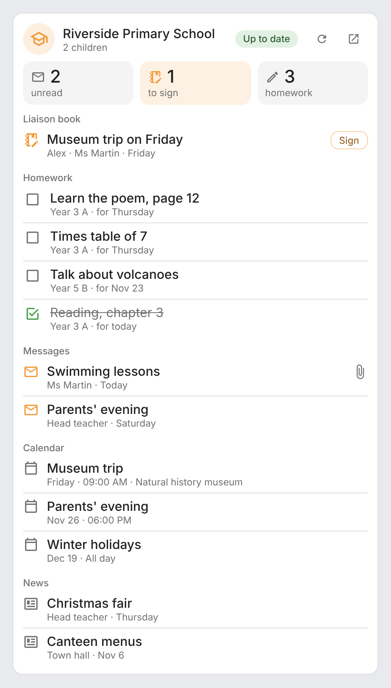

> [!IMPORTANT]
> Unofficial community project, neither made nor endorsed by Edifice, the Éducation nationale or an académie. The ENT has no public API: the integration calls the routes its web application uses, as [ent1-mcp](https://github.com/edouard-claude/ent1-mcp) does, and an ENT update can break it.

## Features

- **Unread messages**, **Words to sign**, **Homework to do** and **News** sensors: a count, with the items (title, author, date, text) as attributes
- **Last update** sensor with the account (school, classes, children) and the upcoming events of the ENT's calendars
- **School** calendar: the ENT's events and every homework on its due date
- One **to-do list per homework notebook**: ticking an item marks the homework done in the ENT, like its check box
- `ent_one.sign_word` action to sign a word of the liaison book (read receipt), `ent_one.refresh` to read the ENT now
- `ent_one_new_message`, `ent_one_new_word` and `ent_one_new_homework` events for automations, and optional **notifications** to the notify actions of your choice
- `custom:ent-one-card` card, **shipped with the integration** and loaded automatically: counts, words to sign (with confirmation), homework to tick, unread messages, calendar and news
- `custom:ent-one-mini-card` compact card: the three counts, with a button to open the full card
- **ENT ONE sidebar panel** with Home, Homework, Liaison book, Messages, News and Settings tabs
- Silent re-login when the ENT session expires; after refused credentials it never retries on its own, so the account is not locked
- Diagnostics download with counts only: no name, message or word ever leaves Home Assistant
- English, French, German, Spanish, Serbian (Cyrillic and Latin), Italian, Dutch, Portuguese, Polish, Romanian, Danish, Swedish, Bulgarian, Russian, Ukrainian, Hungarian, Slovak, Czech, Slovenian, Latvian and Greek

## Supported integrations

<p></p>

The card and the panel read the sensors of this integration only. Any ENT built on Edifice (ENT ONE, NEO, ENT of local authorities) should work with its own address; ENTs that require ÉduConnect, FranceConnect or two-factor login are not supported.

## Prerequisites

- Home Assistant 2024.12 or later
- An ENT ONE account with a username and a password (parent account, usually `firstname.lastname`)
- The address of your académie's ENT, for example `https://ent1d.ac-reunion.fr`

## Installation

### Via the Marketplace (recommended)

Click the button below to add the repository directly:

[](https://my.home-assistant.io/redirect/marketplace_repository/?owner=juju35&repository=ha-ent-one&category=integration)

Then click **Install** and restart Home Assistant.

Or manually:

1. Open **Settings → Marketplace → Add from link** (top right; this needs a GitHub account connected)
2. Add `https://github.com/juju35/ha-ent-one` — Type: **Integration**
3. Open **ENT ONE** and click **Install**
4. Restart Home Assistant

The card is **part of the integration**: at startup it is added to the dashboard resources (`/ent_one_static/ent-one-card.js`, module). After an install or an update, restart Home Assistant and refresh the browser (clear the companion app cache if needed). If your dashboards are in YAML mode, the card is loaded on every page without going through the resources.

### Manual

Copy `custom_components/ent_one/` to `/config/custom_components/ent_one/`, then restart Home Assistant.

## Configuration

### Integration

[](https://my.home-assistant.io/redirect/config_flow_start/?domain=ent_one)

**Settings → Devices & services → Add integration → ENT ONE**, then enter the ENT address, your username and your password. If the ENT asks for an action first (new terms, password change), sign in once in a browser and try again.

Options (**Configure** button, or the panel's **Settings** tab):

| Option | Default | Description |
|---|---|---|
| Update interval | 30 min | Minimum 10 min: the ENT is a school server shared by many families |
| Homework window | 14 days | Homework due within this many days (and yesterday's) is read |
| Notify actions | none | The notify actions (`notify.mobile_app_phone`…) told about each new unread message, word to sign and homework, in Home Assistant's language |
| Show the panel | on | Show the ENT ONE panel in the sidebar |

### Card

Add the **ENT ONE** card from the card picker: every option is set in the visual editor. In YAML:

```yaml
type: custom:ent-one-card
```

| Option | Default | Description |
|---|---|---|
| `config_entry_id` | first account | ENT ONE account to show (useful with several accounts) |
| `title` | school name | Card title |
| `show_title` | `true` | Show the title in the header |
| `show_refresh` | `true` | Show the refresh button |
| `show_words` | `true` | Show the words of the liaison book to sign |
| `show_homework` | `true` | Show the homework |
| `show_done` | `true` | Show the homework already done (after the rest, struck through) |
| `show_messages` | `true` | Show the unread messages |
| `show_events` | `true` | Show the upcoming events of the ENT's calendars |
| `show_news` | `false` | Show the school news |
| `max_items` | `5` | Items per section |
| `language` | Auto | Force language: `en`, `fr`, `de`, `es`, `sr`, `sr-Latn`, `it`, `nl`, `pt`, `pl`, `ro`, `da`, `sv`, `bg`, `ru`, `uk`, `hu`, `sk`, `cs`, `sl`, `lv` or `el` (auto-detects from HA settings) |

**Sign** opens a confirmation at the top of the card, with the word's text: signing cannot be undone in the ENT. The check box of a homework marks it done (or not done) in the ENT.

### Mini card

A compact card for dashboards: unread messages, words to sign and homework to do. The button at the top right opens the full card in place; a click outside the card folds it back.

```yaml
type: custom:ent-one-mini-card
```

It takes the same options as `custom:ent-one-card` (both: set in the same visual editor); they apply to the full view.

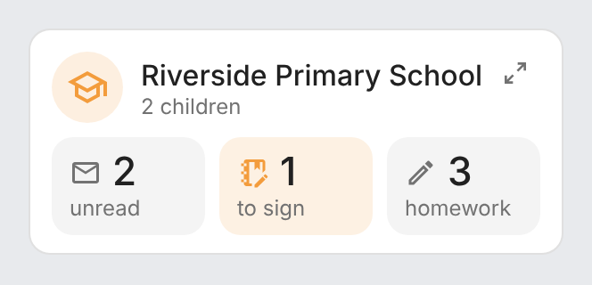

### Panel

The **ENT ONE** entry of the sidebar opens a panel drawn for the ENT, one tab per application (the tab is kept in the address):

| Tab | Content |
|---|---|
| Home | The three counts, words to sign, next homework, calendar and news |
| Homework | Homework by due day, filtered by notebook, with its text; done ones can be hidden |
| Liaison book | Every recent word with its text, to sign |
| Messages | The last messages of the inbox, and a link to the ENT's messaging |
| News | The school news in full |
| Settings | The account options; only administrators can change them |

With several accounts, a menu in the header bar switches between them.

### Actions

```yaml
action: ent_one.sign_word
data:
  word_id: "1234"
  child_id: "abcd-1234"
```

`word_id` and `child_id` come from the `words` attribute of the **Words to sign** sensor. `ent_one.refresh` reads the ENT now. With several accounts, add `config_entry_id`. Errors are translated in the Home Assistant language.

### Events

| Event | When | Data |
|---|---|---|
| `ent_one_new_message` | An unread message appears | `id`, `subject`, `sender` |
| `ent_one_new_word` | A word to sign appears | `id`, `child_id`, `child`, `title` |
| `ent_one_new_homework` | A homework to do appears | `id`, `book`, `date`, `title` |

Every event also carries `config_entry_id`. Nothing fires at startup or after a reload, and an item fires once only.

```yaml
triggers:
  - trigger: event
    event_type: ent_one_new_word
actions:
  - action: notify.mobile_app_phone
    data:
      title: "Word to sign for {{ trigger.event.data.child }}"
      message: "{{ trigger.event.data.title }}"
```

### Diagnostics

**Settings → Devices & services → ENT ONE → ⋮ → Download diagnostics** gives the options and the number of items of each kind. Username, password, names and contents are never included: the ENT holds children's data.

## Screenshots

While the ENT is read, the refresh button spins until the update finishes.

| Light | Dark |
|---|---|
| 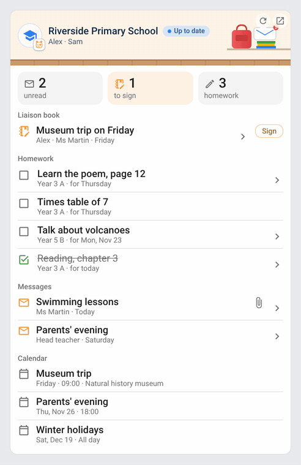 | 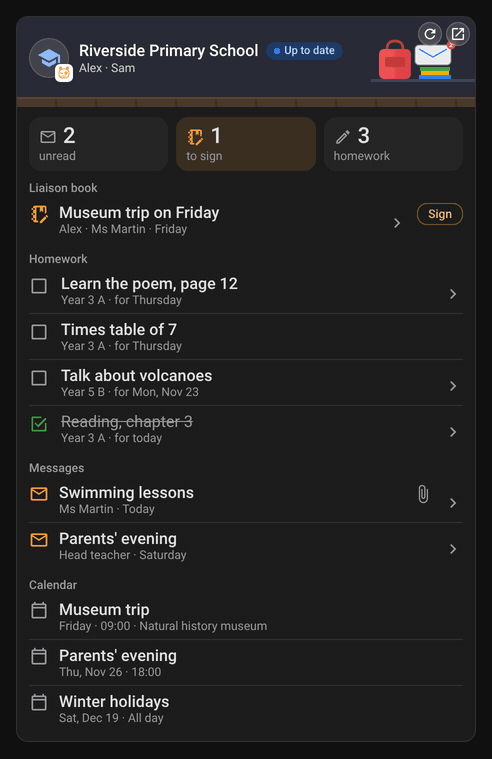 |

The card, with the news shown:

| Light | Dark |
|---|---|
|  | 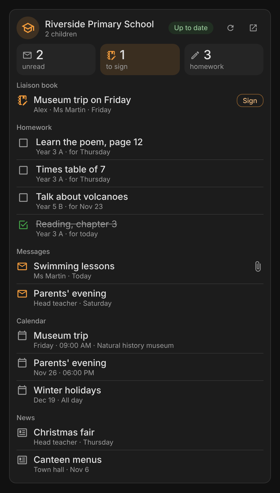 |

Signing a word: the confirmation at the top of the card.

| Light | Dark |
|---|---|
| 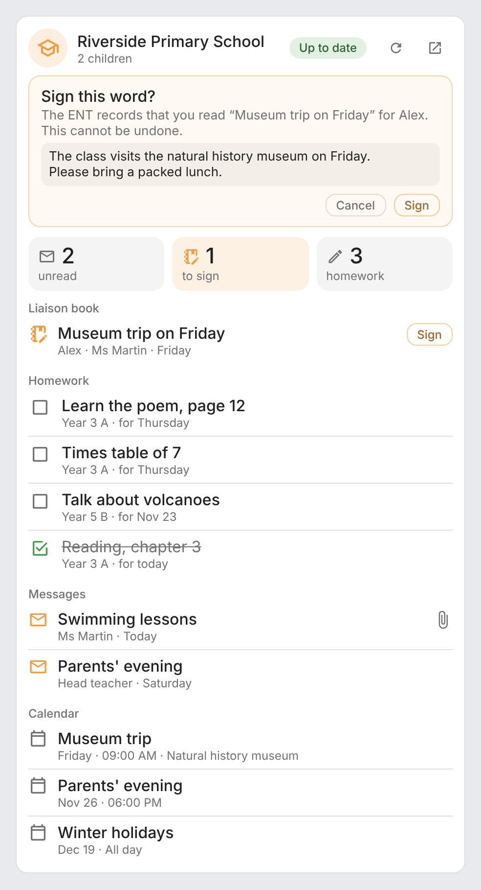 | 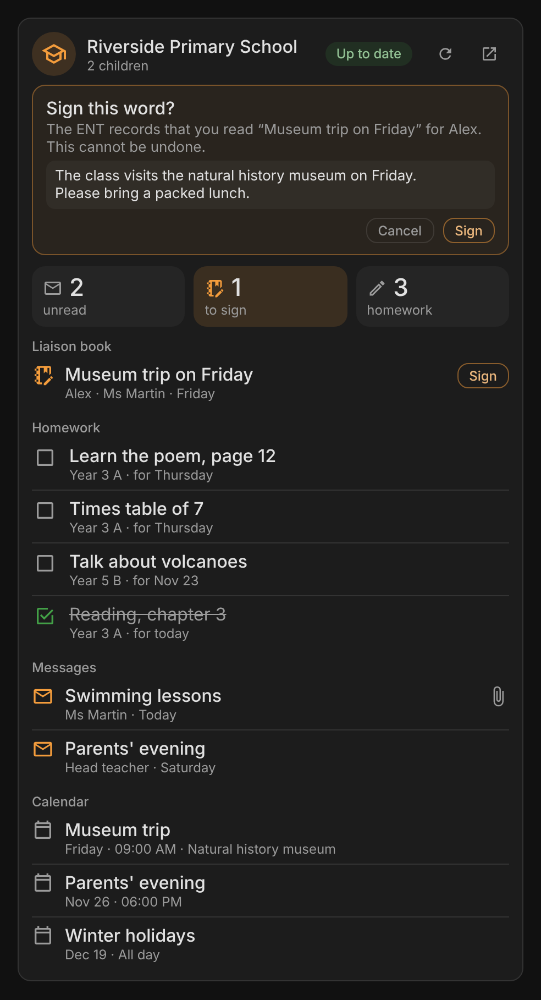 |

The mini card:

| Light | Dark |
|---|---|
|  | 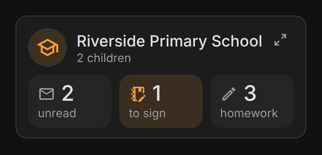 |

The panel, Home and Homework tabs:

| Light | Dark |
|---|---|
| 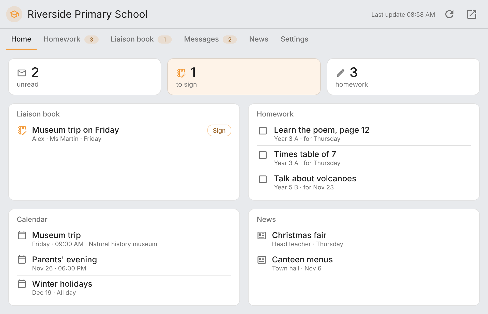 | 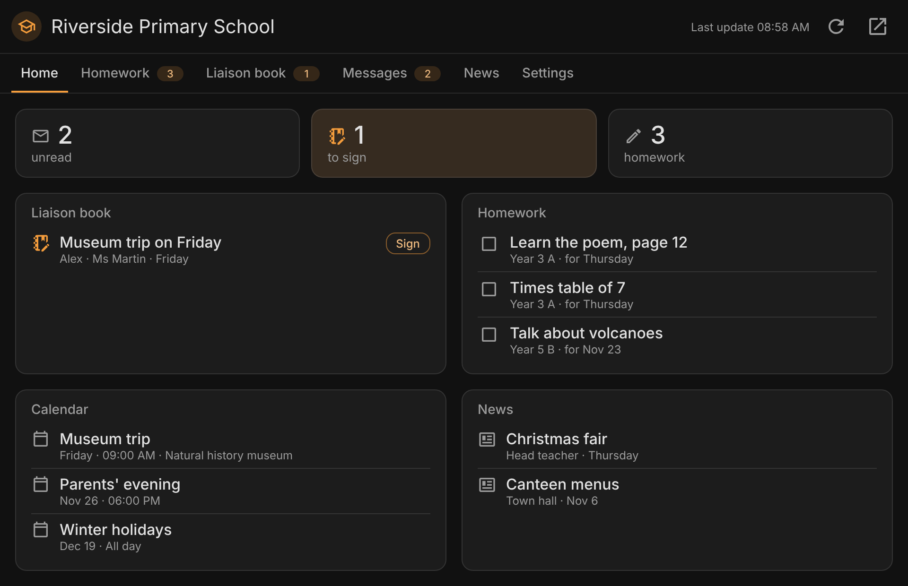 |
| 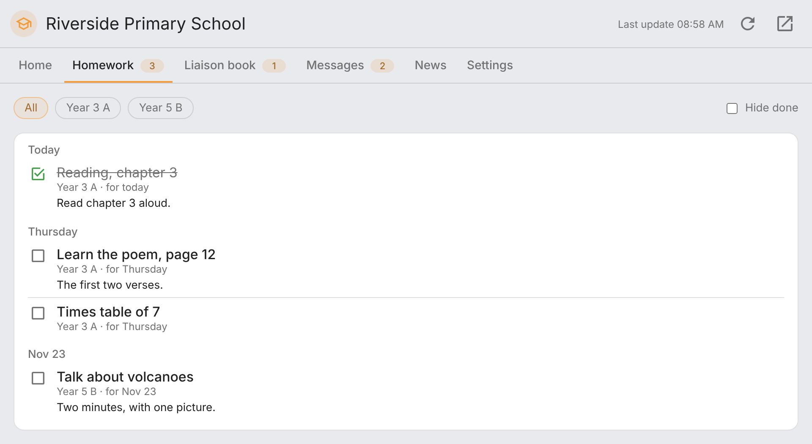 | 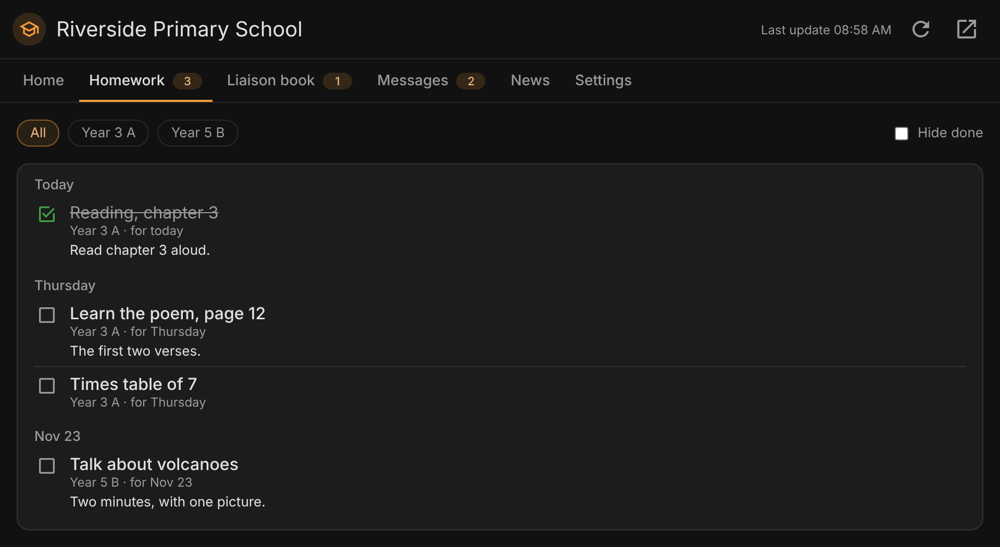 |

## How it works

The integration logs in like the ENT's web page (`POST /auth/login`, session cookie in its own cookie jar, `X-XSRF-TOKEN` on writes) and reads, at each update: the account (`/auth/oauth2/userinfo`), the unread count and last inbox messages (`/conversation`), the liaison book of each child (`/schoolbook`), the homework notebooks and their done statuses (`/homeworks`), the news (`/actualites`) and the calendars (`/calendar`). A lost session (401 or a redirect) triggers one silent re-login and one replay; refused credentials stop every attempt and start a reauthentication. An application missing from an ENT, or failing once, keeps its last content and is listed in the sensors' `stale` attribute; the card then shows *Partly updated*.

## Development

```bash
pip install -r requirements_test.txt && pytest
node --test test/*.test.mjs
pip install playwright==1.64.1 pillow && playwright install chromium
python scripts/screenshots.py   # renders the card, mini card and panel stills and the refreshing GIFs (needs ffmpeg) into screenshots/
```

### Releasing

1. Bump the version in `custom_components/ent_one/manifest.json` and `ENT_ONE_CARD_VERSION` in the card
2. Add a `## <version>` section at the top of [CHANGELOG.md](https://github.com/juju35/ha-ent-one/blob/main/CHANGELOG.md)
3. Merge to `main`: the **Release** workflow creates the tag and the GitHub release with the changelog section as notes

## Translations

The integration, the card and the panel follow the language of Home Assistant (the card's `language` option can force another one). Currently supported:

| Language | Code |
|---|---|
| English | `en` |
| Français | `fr` |
| Deutsch | `de` |
| Español | `es` |
| Српски | `sr` |
| Srpski (latinica) | `sr-Latn` |
| Italiano | `it` |
| Nederlands | `nl` |
| Português (Portugal) | `pt` |
| Polski | `pl` |
| Română | `ro` |
| Dansk | `da` |
| Svenska | `sv` |
| Български | `bg` |
| Русский | `ru` |
| Українська | `uk` |
| Magyar | `hu` |
| Slovenčina | `sk` |
| Čeština | `cs` |
| Slovenščina | `sl` |
| Latviešu | `lv` |
| Ελληνικά | `el` |

Brazilian Portuguese (`pt-BR`): pt-BR uses the European Portuguese texts, in the integration and the card.

Contributions for additional languages are welcome!

## License

[MIT](https://github.com/juju35/ha-ent-one/blob/main/LICENSE)

## Support

If you find this project useful, you can support its development:

<a href="https://buymeacoffee.com/julienstep9"></a>
